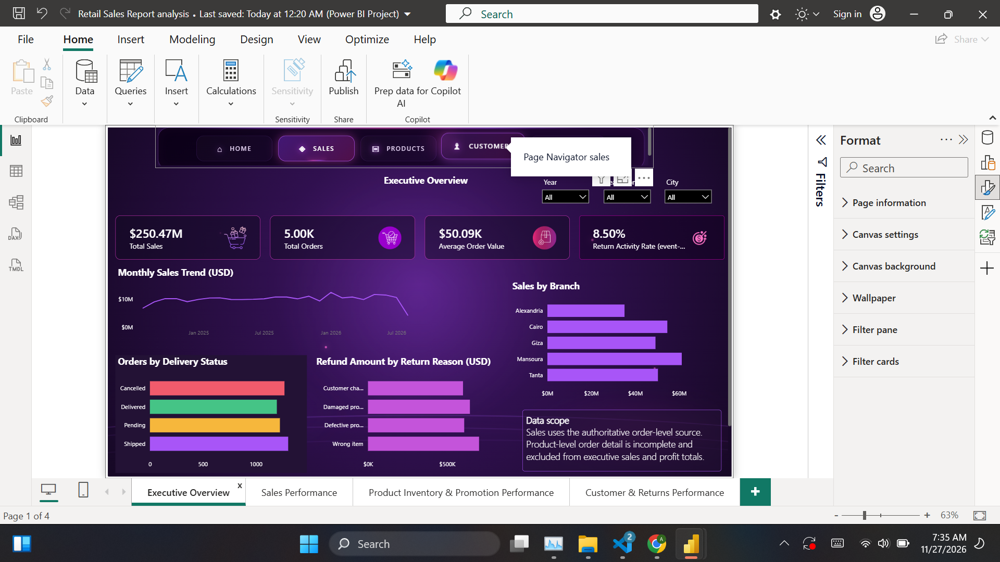
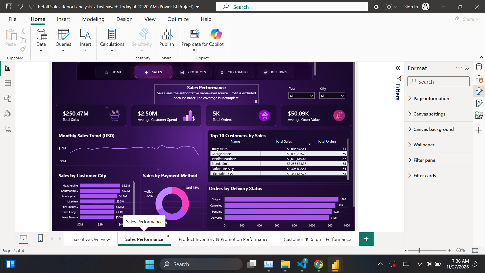
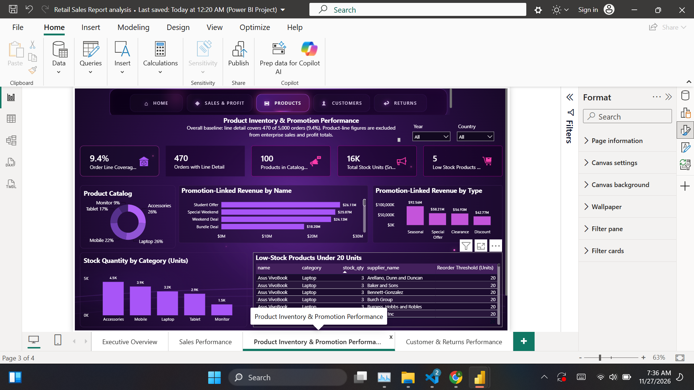
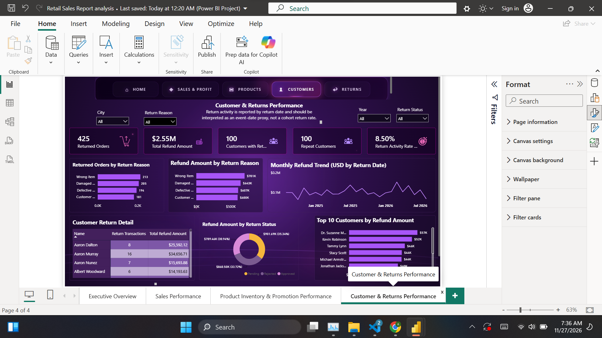

# Retail Sales Report Analysis

## Overview

This Power BI portfolio project analyses retail sales performance, customer activity, returns, inventory, and promotion configuration. It is designed to demonstrate data-quality assessment, semantic-model governance, DAX design, dashboard design, and business communication.

## Business objective

Provide decision makers with a trusted view of order-level sales performance, customer and return activity, delivery status, inventory position, and promotion-related sales.

## Detailed portfolio case study

### Retail Decision Control: Sales, Returns and Inventory Transparency

**Challenge:** The source package combined order headers, incomplete order lines, return transactions, customer records, inventory, and promotions. Combining these without grain and reconciliation controls could make product-level revenue or profit appear to represent the whole business.

**Approach:** Profiled all nine CSV sources; checked missing values, exact duplicates, date validity, numeric fields, and selected key relationships; treated `orders_data.csv` as the authoritative sales source; and used a shared `DimDate` plus governed measures for report calculations. The Power BI report organizes sales, product/inventory/promotion context, and returns into separate decision views.

### **Verified evidence.**

- Order-header data contains 5,000 orders and authoritative sales of **$250,468,770.96**.
- Order-line data covers 470 orders, or **9.4%**, and all 470 comparable order totals differ from the corresponding header totals.
- The return extract contains **1,000 transactions** across **425 distinct returned orders**, with **$2,551,653.41** in refund amounts.
- The largest documented refund reason is “Wrong item” at approximately **$0.70M**; this is a descriptive reason total, not a proven root cause.
- Promotion-linked sales are reported as association, not incremental lift or promotion profitability.

 **Decision value:** The report helps a reviewer distinguish reliable order-level sales and return activity from product-line analysis that is not complete enough for enterprise revenue or margin claims. It also makes the evidence limitations visible rather than hiding them.

**Limitations:** The dataset's source organization and provenance are unknown. The project does not establish that the findings generalize to a real retailer, identify causal drivers, measure realized business outcomes, or validate an intervention. The 2026 annual amount is incomplete relative to a full-year comparison. Return Activity Rate is an event-date proxy, not a cohort return rate.

## Important data scope

- `orders_data.csv` is the authoritative sales source. One row represents one order.
- Product order-line detail covers 470 of 5,000 orders (9.4%) and does not reconcile to order-header totals.
- Product-line profit and margin are therefore excluded from enterprise sales and profit reporting.
- Return activity is analysed by return date. The return-activity rate is not a cohort-based return rate.

## Repository structure

- `data/raw/` — immutable source CSV files.
- `documentation/` — business problem, data dictionary, methodology, insights, data quality, and audit records.
- `python/` — reproducible data-profiling utilities.
- `screenshots/` — curated dashboard screenshots for this README.
- `Retail_sales_store_project.sql` — optional SQL Server implementation.

## Report previews

The following screenshots show the four report pages after the Power BI Desktop review:

### Executive Overview

### Sales Performance

### Product Inventory & Promotion Performance

### Customer & Returns Performance

## Open the Power BI report

1. Open `powerbi/Retail Sales Report analysis.pbip` in Power BI Desktop.
2. Set the `pDataFolder` parameter to the absolute path of this repository's `data/raw` folder.
3. Refresh the model.
4. Confirm the validation checks in [`documentation/qa_checklist.md`](documentation/qa_checklist.md).

## Core KPIs

- Total Sales
- Total Orders
- Average Order Value
- Average Customer Spend
- Returned Orders
- Return Transactions
- Total Refund Amount
- Return Activity Rate
- Repeat Customers
- Order Line Coverage

## Career and hiring assessment

See [`documentation/career_and_hiring_assessment.md`](documentation/career_and_hiring_assessment.md) for role positioning, evidence-based portfolio and interview materials, and the final hiring-manager assessment.

## Refresh and release checks

Before publishing, refresh all tables, reconcile KPI cards to `documentation/data_quality_report.md`, validate slicer interactions, remove development-only pages, and export final screenshots with no contact details visible.

## Tools

Power BI Desktop, Power Query, DAX, Python, pandas, and optional SQL Server.
